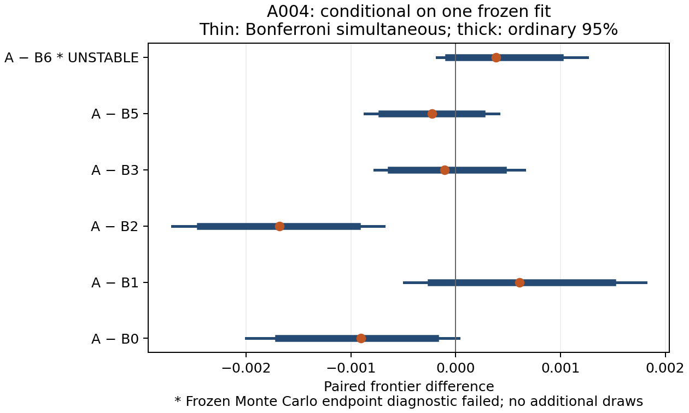

# Reasoning allocation

A solver has a deadline and more branches than it can explore. This project tests whether a small learned scheduler can spend that time better: choose a search subtree, choose how long to stay there, and charge the scheduler for the time it takes to decide.

**The first experiment favored the simple rule.** Across 60 independent weighted-set-cover problems and 2,520 cold requests, the learned bidder lost to a minimum-estimate selector that reconsidered after each node. It established no advantage over native SCIP. Those native comparisons remain inconclusive; this is one fitted model bundle on a designed synthetic workload.

[Full findings](REPORT.md) · [Claims and limits](CLAIMS.md) · [Reproduction](REPRODUCE.md) · [Citation](CITATION.cff)

## The idea

SCIP searches a tree of partial decisions. The scheduler predicts the optimization progress and execution time of an investment such as “work inside this subtree for eight processed nodes,” ranks those investments by predicted gain per second, and leases the selected subtree. When the lease ends, it chooses again.

The solver keeps its branching, LP, cuts, presolve and primal heuristics. Allocation changes the order of work and how long a subtree keeps control. The learner uses local node and ancestry features plus a few task-wide scalars; it doesn't run a hidden continuation to discover which bid should win.

Every bid costs time. Imports, model loading, setup, callbacks, verification and observation all count toward the cold request. Only output received and verified by the deadline contributes to its score. “Bid,” “credit” and “population” are bookkeeping terms; funding a search region doesn't add evidence or improve its bound.

## What happened

The frozen study used three generated cover families at two sizes, one fitted bundle, two timing repeats, and separate runs at approximately **0.53, 2.11 and 8.43 seconds**. Seven physical methods produced 2,520 requests: 1,640 completed and 880 reached their deadlines. All outcomes are included; the study recorded no faults or retries.

The primary score averages normalized primal–dual progress across the three log-spaced deadlines. It includes both the feasible solution and its optimality bound. Differences below are **utility percentage points, learned bidder minus comparator**; positive favors the bidder. The intervals account for all six registered comparisons.

| Comparator | Difference | Simultaneous interval | Finding |
| --- | ---: | ---: | --- |
| Native SCIP default | −0.091 | [−0.200, +0.003] | Inconclusive |
| Validation-tuned native scheduling | +0.061 | [−0.049, +0.181] | Inconclusive |
| Minimum estimate, one-node investment | **−0.168** | **[−0.271, −0.068]** | **Bidder worse** |

The report retains the other learned controls, individual deadlines, primal and dual changes, failures and resource costs. The pooled-context comparison failed its frozen Monte Carlo stability diagnostic, which the report flags. Narrow intervals against two other controls don't establish equivalence.



Administration consumed about **30%** of the bidder's accounted worker time at the longest deadline, versus **7%** for the simple selector. A separate 36-request diagnostic found lower search progress when scheduling delay was added. That shows latency sensitivity; it doesn't explain away the bidder's loss or establish a speedup after optimization.

Utilities were near their ceiling. Variation across independent training runs, industrial workloads and transfer remain untested. Five literature selectors weren't faithfully reproduced, so this project claims no win over them. Population engineering and transfer stayed behind unmet experimental gates.

## What you can use

The reusable piece is the experiment: a native SCIP adapter, bounded subtree leases, exact cover-feasibility checks, receipt-based deadlines, resource accounting, learned and heuristic controls, guarded data splits, and paired analysis. It gives another allocation policy somewhere concrete to be tested, with its overhead included.

This checkout includes source, tests, figures, summary tables and compact execution receipts. Full raw traces, generated inputs, fitted models, wheels, environments and the detailed local audit archive remain external. A clone can run the software checks below and inspect the summary evidence; **full raw-result authentication requires the retained assets**. [Publication scope](docs/PUBLICATION.md) and [reproduction instructions](REPRODUCE.md) distinguish those operations.

## Run the checks

The measured environment was native macOS ARM64 on an M3 Max with 36 GiB RAM: Python 3.12.9, PySCIPOpt 6.3.0, SCIP 10.0.2 and SoPlex 8.0.2. The supplied hash lock targets Python 3.12/macOS ARM64 wheels. Other platforms need their own dependency resolution and native checks.

```sh
git clone https://github.com/arlegotin/reasoning-allocation.git
cd reasoning-allocation
python3.12 -m venv .venv
. .venv/bin/activate
python -m pip install --only-binary=:all: --require-hashes -r requirements.lock
python -m pip install --no-deps -e .
python -m pip check
ra check --suite analytical --out artifacts/checks
OPENBLAS_NUM_THREADS=1 OMP_NUM_THREADS=1 LOKY_MAX_CPU_COUNT=1 \
  python -m pytest -q tests/test_design_checks.py tests/test_scip_smoke.py
```

These checks use authored fixtures and a tiny cover with a known optimum. They need no research archive, external dataset, GPU or paid inference service. The archived amended-source suite passed 804 tests; that is software verification, not another solver-performance result.

## License and citation

Copyright © 2026 Artem Legotin. Original software is **AGPL-3.0-only**; original writing and result presentation are **CC BY 4.0**. [Licensing](LICENSING.md) defines the split, and [third-party notices](THIRD_PARTY_NOTICES.md) retain dependency and embedded-font boundaries.

Please cite [CITATION.cff](CITATION.cff) and record the commit you used. Citation is requested separately from the licenses' conditions. Implementation, experiment execution and documentation used AI assistance under the project owner's direction.
